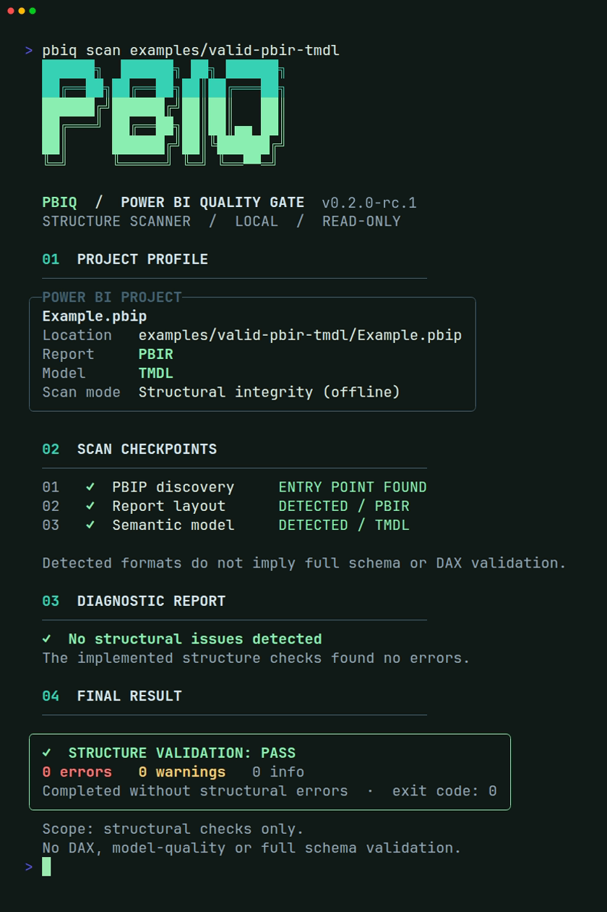
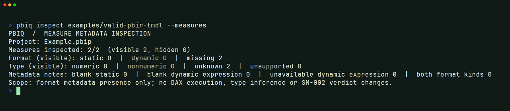
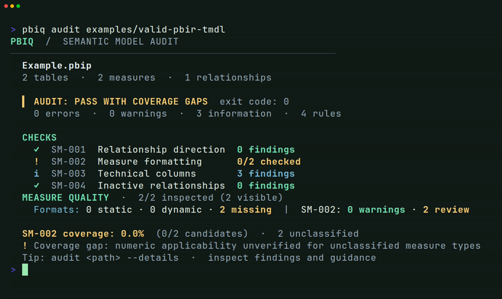
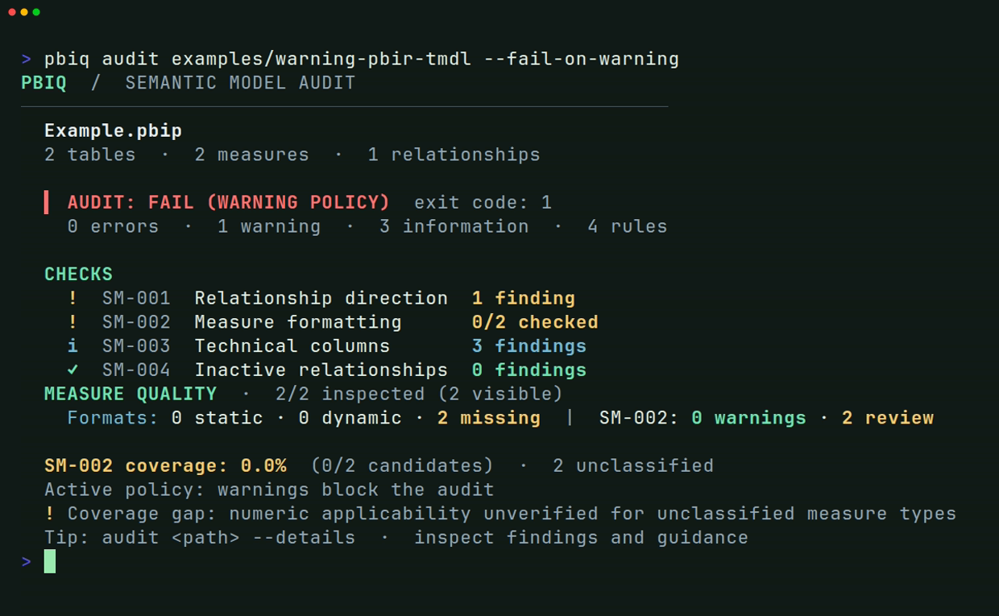

<div align="center">

# 🌵 PBIQ

### Power BI Quality Gate

**Scan PBIP structure. Inspect TMDL metadata. Audit PBIP and Fabric Git semantic models.**

An offline, read-only CLI for Power BI Project (`.pbip`) files and native
Fabric Git `.SemanticModel` folders, built for analysts, BI developers and CI pipelines.

[](https://github.com/dawidthecactus/powerbi-quality-gate/actions/workflows/ci.yml)


[](LICENSE)
[](https://github.com/dawidthecactus/powerbi-quality-gate/releases/tag/v0.3.0-alpha.1)

**[5-minute Quick Start](docs/quick-start.md) · [Commands](#three-commands-one-workflow) · [Quality gates](#use-it-as-a-quality-gate) · [Docs](#documentation)**

</div>

> [!IMPORTANT]
> **Latest published release:** [v0.3.0-alpha.1](https://github.com/dawidthecactus/powerbi-quality-gate/releases/tag/v0.3.0-alpha.1) is available as self-contained **Windows x64** and **Linux x64** binaries. It includes JSON, SARIF, YAML policy configuration, source locations, GitHub Actions and native Fabric Git auditing. **This is an alpha prerelease, not a stable production validator.** The older [v0.2.0-rc.1](https://github.com/dawidthecactus/powerbi-quality-gate/releases/tag/v0.2.0-rc.1) lacks these features. See the [Quick Start](docs/quick-start.md).

## See what PBIQ does

One tool, three levels of feedback:

| | Command | What you learn |
| :-- | :-- | :-- |
| **01** | `scan` | Is the PBIP project structure valid? |
| **02** | `inspect` | What does the local TMDL semantic model contain? |
| **03** | `audit` | Which metadata quality rules need attention, and should CI block? |

A real, synthetic-fixture example of the **single-line CI output**:

```text
$ pbiq audit examples/valid-pbir-tmdl --quiet
PBIQ | AUDIT: PASS WITH COVERAGE GAPS | 0 errors, 0 warnings, 3 information | exit code: 0
```

`PASS WITH COVERAGE GAPS` is intentionally not the same as “everything is
correct.” Some measure types remain `Unknown` in offline TOM, so numeric-format
applicability cannot always be confirmed. See [how to interpret the output](#understand-the-results).



<details>
<summary><strong>More terminal screenshots: measure inspection, audit PASS and audit FAIL</strong></summary>

**Measure metadata inspection** (plain text by design)



**Audit with explicitly reported coverage gaps**



**Strict warning policy**



</details>

*The screenshots use the included synthetic examples and are cropped for readability. CLI output and policy results are not simulated.*

## New in v0.3.0-alpha.1: audit automation

The v0.3 source tree provides **[JSON schema v1](docs/audit-json-contract-v1.md)**,
**[SARIF 2.1.0](docs/milestone-03.4-sarif-github-annotations.md)** with verified
TMDL file/line locations, **`.pbiq.yml`** policies and exclusions,
**[a composite GitHub Action](docs/milestone-03.5-reusable-action.md)** and
**[native Fabric Git](docs/milestone-03.6-fabric-git.md)** support for `audit`.
These features are **included in the published [v0.3.0-alpha.1](https://github.com/dawidthecactus/powerbi-quality-gate/releases/tag/v0.3.0-alpha.1) prerelease**, but not in the older v0.2.0-rc.1 binaries.

```powershell
# After checking out and building a reviewed v0.3 source revision:
dotnet run --no-build -c Release --project src/PowerBIQualityGate.Cli -- audit examples/fabric-git/Revenue.SemanticModel --format json
dotnet run --no-build -c Release --project src/PowerBIQualityGate.Cli -- audit examples/fabric-git/Revenue.SemanticModel --format sarif --sarif-source-root .
```

## Quick start

**Fastest installation:** follow the [5-minute Quick Start](docs/quick-start.md) to download a standalone binary, verify SHA256 and audit a synthetic or local Power BI model. No .NET SDK is required.

### Option A: build from source

Requires [Git](https://git-scm.com/) and the [.NET 10 SDK](https://dotnet.microsoft.com/download/dotnet/10.0).
Run these commands from PowerShell 7 or a shell with `dotnet` available:

```powershell
git clone https://github.com/dawidthecactus/powerbi-quality-gate.git
cd powerbi-quality-gate
dotnet restore
dotnet build -c Release

dotnet run --no-build -c Release --project src/PowerBIQualityGate.Cli -- scan examples/valid-pbir-tmdl
dotnet run --no-build -c Release --project src/PowerBIQualityGate.Cli -- inspect examples/valid-pbir-tmdl --measures
dotnet run --no-build -c Release --project src/PowerBIQualityGate.Cli -- audit examples/valid-pbir-tmdl --quiet
```

The bundled examples are **synthetic regression fixtures**, not reports that
are guaranteed to open or refresh in Power BI Desktop.

For detailed installation steps, see **[Getting started](docs/getting-started.md)**.

### Option B: standalone v0.3 alpha executable

Download `pbiq-win-x64.zip` or `pbiq-linux-x64.tar.gz` from the
[published v0.3.0-alpha.1 release](https://github.com/dawidthecactus/powerbi-quality-gate/releases/tag/v0.3.0-alpha.1), along with `SHA256SUMS.txt`. These are self-contained x64 builds and do
not require a .NET runtime on the target machine.

<details>
<summary><strong>Windows x64 (PowerShell)</strong></summary>

```powershell
Expand-Archive .\pbiq-win-x64.zip -DestinationPath .\pbiq -Force
& .\pbiq\pbiq.exe --version
& .\pbiq\pbiq.exe scan 'C:\Reports\MyReport.pbip'
$LASTEXITCODE
```

</details>

<details>
<summary><strong>Linux x64 (bash)</strong></summary>

```bash
mkdir -p pbiq
tar -xzf pbiq-linux-x64.tar.gz -C pbiq
./pbiq/pbiq --version
./pbiq/pbiq scan ./reports/MyReport.pbip
echo $?
```

</details>

macOS and ARM64 standalone distributions are **not yet available**.
See the [release process](docs/release-process.md) for packaging, checksums,
and the candidate-to-stable release policy.

## Three commands, one workflow

`scan` and `inspect` accept PBIP inputs only. `audit` also accepts a native
Fabric Git `.SemanticModel` folder or a directory containing exactly one
such model and no PBIP shortcut. Replace `<path>` with your own local input.

| Command | Purpose | Useful options |
| --- | --- | --- |
| `pbiq scan <path>` | PBIP discovery, report/model references and implemented structural checks (`PBI-001`–`PBI-018`) | `--no-color` |
| `pbiq inspect <path>` | Lightweight, local TMDL declaration inventory | `--no-color` |
| `pbiq inspect <path> --tom` | Semantic-model metadata through the official Microsoft TOM reader | `--no-color` |
| `pbiq inspect <path> --measures` | Privacy-conscious **aggregate** measure formatting and type inventory | `--no-color` |
| `pbiq audit <path>` | Four semantic-model metadata checks (`SM-001`–`SM-004`) | `--format json`, `--format sarif`, `--sarif-source-root .`, `--config .pbiq.yml`, `--fail-on-warning`, `--min-measure-coverage 95`, `--details`, `--quiet` |

`inspect --tom` and `inspect --measures` cannot be used together.
`audit --quiet` and `audit --details` are also mutually exclusive.

**Tip:** Add `--no-color` or set `NO_COLOR` for plain terminal logs. Leave it
out when taking the **color** screenshots. The detailed audit includes model
object locations, so do not paste its output into public issues without
reviewing it first. See the **[complete CLI reference](docs/commands.md)**.

## Understand the results

| Audit status | What it means |
| --- | --- |
| **PASS** | Evaluated rules did not report blocking findings under the selected policy. |
| **PASS WITH COVERAGE GAPS** | No blocking finding, but some measure-type eligibility could not be determined from offline metadata. |
| **FAIL (WARNING POLICY)** | `--fail-on-warning` is active and a Warning was found. |
| **FAIL (COVERAGE POLICY)** | Measure-type classification coverage was below your explicit minimum. |

The four current metadata rules:

| Rule | Checks | Default severity |
| --- | --- | --- |
| `SM-001` | Active bidirectional relationships | Warning |
| `SM-002` | Missing format on a **confirmed numeric** visible measure | Warning |
| `SM-003` | Visible technical/key columns | Information |
| `SM-004` | Inactive relationships | Information |

For `SM-002`, the public example can have **2/2 measure formats inspected**
but **0/2 candidate types classified**. These are different measurements. A
format marked `Missing` for an unknown type is a *review item*, not
automatically a warning. PBIQ does not infer numeric types from DAX.

### Exit codes

| Code | `audit` | `scan` |
| :--: | --- | --- |
| `0` | Evaluated, no blocking finding under the chosen policy | Implemented structural checks passed |
| `1` | Blocking finding/policy, or structural validation failure | Structural validation failed |
| `2` | Unable to evaluate, bad input or incompatible options | Project discovery failed |

**Exit `0` is not a DAX, refresh, performance or Power BI Desktop certification.**
For the complete status guide, see **[Reading PBIQ output](docs/output-guide.md)**.

## Use it as a quality gate

The default audit is advisory for Warnings. For stricter CI, opt into either
policy independently or combine them:

```powershell
# From a cloned source repository after dotnet build -c Release
$project = 'examples/warning-pbir-tmdl'

dotnet run --no-build -c Release --project src/PowerBIQualityGate.Cli -- audit $project --quiet
# Advisory: warnings are reported, but do not block by default.

dotnet run --no-build -c Release --project src/PowerBIQualityGate.Cli -- audit $project --fail-on-warning --no-color
# Exit 1 for this synthetic fixture (intentional SM-001 warning).

dotnet run --no-build -c Release --project src/PowerBIQualityGate.Cli -- audit examples/valid-pbir-tmdl --min-measure-coverage 95 --quiet
# Exit 1 because the sample's offline measure types are Unknown.
```

For a GitHub Actions workflow, treat nonzero exit codes according to your
policy. The project itself runs builds, tests and CLI regressions on **Windows
and Ubuntu**. See the **[ready-to-adapt GitHub Actions example](docs/ci-integration.md)**.

## Safety, scope and privacy

- **Read-only and offline:** no Power BI service sign-in, data refresh, model
  writeback or DAX execution.
- **Local TMDL required:** `inspect` needs PBIP with TMDL; `audit` accepts
  PBIP with TMDL or a local Fabric Git `.SemanticModel` folder. Standalone
  PBIR, TMSL-only and external/live model connections are not supported.
- **Metadata checks, not a full validator:** structural checks do not implement
  the entire Microsoft JSON Schema; the four SM rules are conservative,
  inspectable suggestions, not proof of a model defect.
- **Review output before sharing:** `scan` and detailed output can include
  project paths and object names; `inspect --measures` avoids printing measure
  names and DAX but still identifies the input project. Never commit private
  PBIP/TMDL files or screenshots containing customer metadata.
- **Path security:** file/path checks are lexical and not hardened against
  hostile symlinks or junctions.

## Documentation

| Guide | Read when you want to... |
| --- | --- |
| **[5-minute Quick Start](docs/quick-start.md)** | Download v0.3 alpha, verify checksum and run the first audit without installing .NET |
| **[Getting started](docs/getting-started.md)** | Install or build PBIQ, verify a first run, and troubleshoot basic errors |
| **[CLI command reference](docs/commands.md)** | Find every command mode, option and exit-code contract |
| **[Output & coverage guide](docs/output-guide.md)** | Interpret PASS, warnings, Unknown types and SM-002 coverage |
| **[CI integration](docs/ci-integration.md)** | Add a pinned PBIQ quality gate to GitHub Actions or local scripts |
| [JSON contract v1](docs/audit-json-contract-v1.md) | Understand structured diagnostics, suppression counts and source locations |
| [SARIF & Code Scanning](docs/milestone-03.4-sarif-github-annotations.md) | Export findings to SARIF and understand GitHub annotation limits |
| [Reusable GitHub Action](docs/milestone-03.5-reusable-action.md) | Use PBIQ from a checked-out consumer repository |
| [Fabric Git input](docs/milestone-03.6-fabric-git.md) | Audit native `.SemanticModel` items without PBIP |
| [v0.3 release readiness](docs/release-readiness-03.7.md) | See remaining PR, package and prerelease gates |
| [Project structure checks](docs/current-checks.md) | Understand `PBI-001`–`PBI-018` |
| [TMDL and TOM inspector](docs/tom-inspector-preview.md) | Explore supported inspection modes |
| [Measure inspection](docs/measure-inspection-02.4.5.md) | Understand static/dynamic/missing formats and type coverage |
| [Semantic-model rule pack](docs/first-rule-pack.md) | Read the `SM-001`–`SM-004` definitions |
| [Audit output and explanations](docs/minimal-terminal-experience-02.4.4.md) | Interpret summary, details and quiet modes |
| [Coverage-aware quality gate](docs/coverage-aware-gate-02.4.3.md) | Configure a minimum SM-002 classification rate |
| [Real-world validation](docs/measure-hardening-02.4.5.5.md) | Benchmark local models without publishing their metadata |
| [Release and checksum guide](docs/release-process.md) | Test/download self-contained builds |
| [Terminal screenshots](docs/terminal-screenshots-02.5.3.3.md) | Reproduce and review real CLI captures |
| [README media plan](docs/readme-media-plan-02.5.3.1.md) | Read the design and capture checklist |

See also the [synthetic fixtures](examples/README.md),
[contribution guide](CONTRIBUTING.md) and [MIT license](LICENSE).

## Contributing

PRs, bug reports and feature suggestions are welcome. Run `dotnet test -c
Release` and `dotnet format whitespace --verify-no-changes` before submitting
changes. Please use sanitized or synthetic models in public reproductions.
See [CONTRIBUTING.md](CONTRIBUTING.md) for the full workflow.

---

<p align="center"><sub>Built for practical Power BI quality checks, with transparent limits and reproducible results. 🌵</sub></p>
